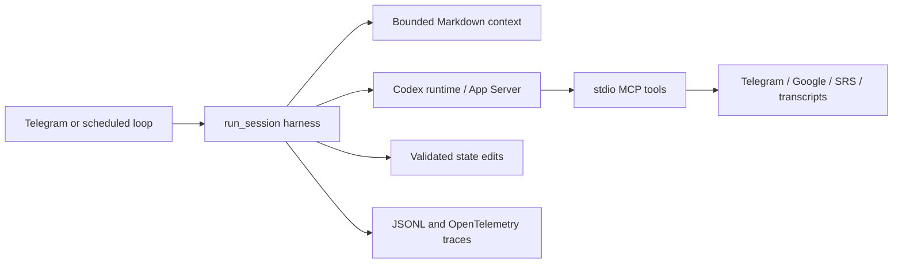

# Tutor: a personal AI learning agent

Tutor runs two Telegram study agents, one for ML/AI interviews and one for
English. The agents keep durable learning state in Markdown, run scheduled
teaching and review loops, use MCP tools for external work, and trace sessions
for diagnosis. The model runtime is the Python Codex SDK with a local App
Server under the user's own ChatGPT subscription.

This is the **public agent source**, including the runtime, harness, Telegram
adapters, prompts, MCP implementations, SRS, TTS, and a Docker example. Learner
history, messages, credentials, paid materials, and production state are not
included. Generic templates let a reader create their own local state.

## Architecture



- `src/tutor/bot.py`, `cards_bot.py`, and `loop.py` are the user and schedule
  entry points. They meet in `harness.run_session()`.
- `src/tutor/context.py` builds a bounded view of canonical Markdown state.
  Sessions are stateless; durable progress lives in `tutors/<subject>/`.
- `src/tutor/runtime.py` hosts the Codex runtime behind an `AgentRuntime`
  boundary. External capabilities are exposed through stdio MCP, with tool
  schemas kept separate from provider-specific SDK code.
- `src/tutor/structured.py` validates structured decisions and state edits.
  JSONL and OpenTelemetry/Arize Phoenix support debugging.
- `src/tutor/srs.py` and `tts.py` provide FSRS/SQLite repetition and local
  Kokoro ONNX speech for the English tutor.

## English-content subtitle MCP

The English tutor can prepare a short list of expressions **before** the
learner watches a video. `src/tutor/tools/transcript.py` exposes two MCP tools:

| Tool | What it does |
| --- | --- |
| `fetch_subtitles(url, lang)` | Uses `yt-dlp --skip-download` for available human or auto captions. It extracts text from VTT/SRT, dropping timestamps, markup, and adjacent repeated lines. |
| `fetch_page(url)` | Fetches a transcript web page with `httpx` and keeps block boundaries while removing HTML. |

The `episode` prompt checks that the text belongs to the selected video or
episode, then chooses a small set of expressions to notice while watching.
**No verified transcript means no list.** The tool does not download video or
transcribe audio when captions are unavailable. The public prompt is generic;
no learner-specific examples or copyrighted transcripts are bundled.

## Repository layout

| Path | Contents |
| --- | --- |
| `src/tutor/` | Full agent implementation and MCP integrations |
| `prompts/` | General and subject-specific instructions |
| `templates/` | Empty interview and English learner state templates |
| `scripts/init_state.py` | Creates a local `tutors/` directory from templates |
| `deploy/` | Dockerfile, schedule, and a Compose example for one trusted learner |

## Local setup

Python 3.11+, `uv`, Telegram bot tokens, and a separately authenticated
product `CODEX_HOME` are needed for a real session. Google tools also require
the user's own OAuth setup. Use an isolated environment and never commit
`.env`, `token.json`, `tutors/`, `logs/`, or `CODEX_HOME`.

```bash
uv sync --frozen
python scripts/init_state.py --learner-name "Your name"
cp .env.example .env
# Fill in your own Telegram tokens and chat ID; authenticate Codex separately.
uv run python -m tutor.bot --tutor english
```

The transcript MCP can be inspected without starting a bot:

```bash
uv run python -m tutor.mcp_stdio --server transcript --tutor english
```

The MCP command waits for a client on stdin/stdout. `deploy/compose.example.yaml`
is a reference, not a safe configuration for accepting untrusted public users:
it uses host networking and mounts credentials from the local machine. Review
its paths, timezone, and isolation before any deployment. This code does not
switch the project to separately billed OpenAI API access.

## Public snapshot limits

This export is based on the last committed single-user agent implementation.
Uncommitted multi-user isolation work in the private project is not part of the
public repository. A real end-to-end session needs the reader's own accounts,
state, content, and model authorization; none were invoked while preparing this
public snapshot.
